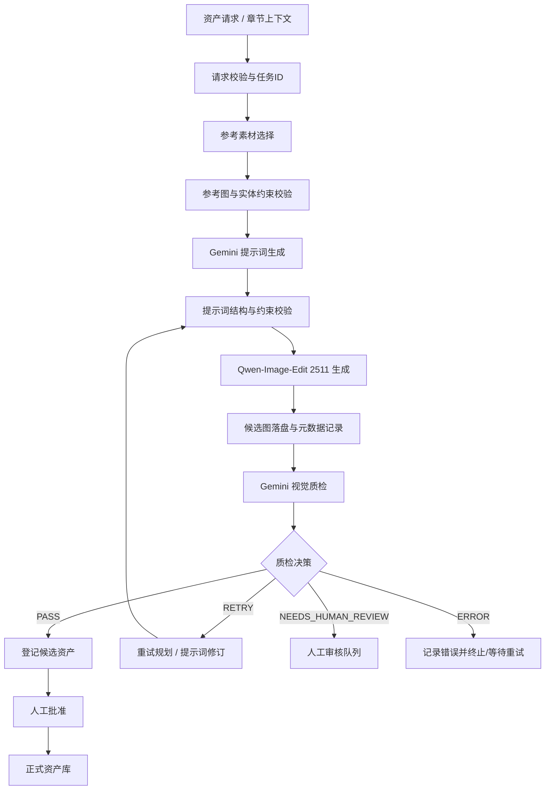

# Comic Asset 自动化图片生成工作流：实现方案与开发清单

> 用途：作为 `yuiyideyui/optimize_prompt` 后续完善自动化图片生成链路的开发文档。本文把**当前代码中已有的模块**与**建议新增/调整的目标能力**分开描述，避免把“有节点”误认为“端到端自动化已经完成”。
>
> 当前目标：从漫画章节/资产请求出发，自动检索合格参考素材、生成 Qwen-Image-Edit 2511 提示词、生成图片、执行视觉质检、在需要时自动重试，并将最终候选图及其生成来源写入资产库；正式资产仍由人工审核批准。

---

## 1. 目标与非目标

### 1.1 本阶段目标

实现一条可以重复运行、可追踪、失败可恢复的图片资产生成闭环：

1. 接收一条明确的图片资产请求。
2. 根据项目、实体、外观版本、场景和约束检索可用参考图。
3. 校验参考图状态、关联关系、冲突规则与文件完整性。
4. 生成有结构的 Qwen-Image-Edit 2511 提示词。
5. 调用图像生成能力，产出候选图片。
6. 对候选图执行视觉质检，输出结构化结果。
7. 质检失败时根据错误类型制定修订提示词并有限次数重试。
8. 将每轮输入、输出、提示词、参考素材、参数、质检结果和错误信息持久化。
9. 成功时登记为 `candidate`；经过人工审核后才能升级为正式可复用资产。

### 1.2 本阶段暂不做

- 不让模型自动覆盖或删除已批准资产。
- 不把未经审核的候选图自动用作后续任务的正式参考图。
- 不要求一次性完成整章漫画的所有人物、场景、道具生成。先打通**单资产请求的闭环**，再扩展为批处理。
- 不把 Gemini/Qwen 的自由文本回答直接写入数据库；所有外部模型响应都必须校验结构、字段和允许的枚举值。

### 1.3 完成定义

给定一条合法资产请求，工作流能够在无需人工手动重连节点或手动复制提示词的情况下完成：

`请求 → 参考素材 → 提示词 → 图片生成 → 质检 → (重试或候选资产入库) → 人工审核`

工作流必须能解释每张候选图是如何生成的，并且在 API 失败、质检失败、ComfyUI 中断或重复提交时，不产生难以区分的重复正式资产。

---

## 2. 当前代码基线与待核对项

以下是本轮按当前分支实际代码核对后的基线。自定义类型用于 ComfyUI 节点间的数据契约，JSON 输出用于调试、持久化或下游节点。

| 文件 / 模块 | 已有职责（基于现有代码结构） | 需要补齐或验证的点 |
|---|---|---|
| `create_manga_story/nodes/qwen_edit_2511.py` | `QwenImageEditCustomNode.edit_image(...) -> (IMAGE,)`；`generate_qwen_image_edit(...) -> IMAGE`；必需 `image1/prompt/unet_name/clip_name/vae_name/seed/steps/cfg`，可选 `image2/image3`；内部复用 ComfyUI 原生加载、编码、采样和解码节点 | `image1` 现在优先接收按实体 `crop_box` 裁剪后的漫画区域，而不是整页 |
| `create_manga_story/nodes/asset_nodes.py` | 资产请求构建、资产登记、资产查询、资产加载，以及 `ComicAssetAutoTargetBatchBuilder` | 批量目标节点遍历当前页全部 `characters` 和 `locations`，使用 `matched_entity_id` 或落库后的 `entity_id`，不按人物重要性或置信度筛选；优先查询 approved 参考图，没有时使用当前页原图作为临时首次参考 |
| `create_manga_story/nodes/asset_workflow_nodes.py` | `ComicAssetReferenceSelector` 输出 `IMAGE x3 + COMIC_ASSET_REFERENCES + manifest_json`；`GeminiAssetPromptGenerator` 输出 `COMIC_ASSET_PROMPT + qwen_prompt + report_json`；`GeminiAssetVisualQC` 输出 `COMIC_ASSET_QC + decision + qc_json`；`ComicAssetWorkflowRegistrar` 输出 `COMIC_ASSETS + COMIC_ASSET_REPORT`；`GeminiQwenAssetGenerationLoop` 输出 `IMAGE + report + decision`；`ComicAssetBatchGenerationLoop` 串行处理页面人物/场景请求 | `crop_box` 先由 Gemini 分析输出并保存到请求/manifest；生成循环先裁剪原页，再把裁剪图交给 Gemini 提示词、Qwen 和 QC；无 approved 资产时使用 `source_page_id + crop_box` 临时参考 |
| `create_manga_story/__init__.py` | 注册资产请求、参考图、提示词、QC、登记、自动目标批量构建和批量循环节点 | 已注册 `ComicAssetAutoTargetBatchBuilder`、`ComicAssetBatchGenerationLoop` 与自动循环节点 |
| `create_manga_story/tests/test_asset_management.py` | 已有资产管理相关测试 | 补齐端到端编排、失败恢复、重试上限、重复任务和模型异常测试 |
| `create_manga_story/asset_generation_single.json` | 按真实节点端口连接“请求 → 参考图 → Gemini 提示词 → Qwen → QC → candidate 登记” | 已提供；API key 留空，模型文件名需在目标 ComfyUI 中选择实际可用文件 |

**重要开发原则：先核对现有接口再修改。** 不要仅凭节点类名猜测输入输出类型；先查看 `INPUT_TYPES`、`RETURN_TYPES`、`RETURN_NAMES`、`FUNCTION`、数据库模型和调用方式，并在本文件中记录最终契约。

---

## 3. 目标架构

建议采用“**可复用服务层 + ComfyUI 节点适配层 + 工作流编排层 + 持久化层**”。这比在一个巨型节点里直接复制所有模型/数据库逻辑更容易测试和维护。



### 3.1 分层职责

- **服务层**：实现参考素材查询、提示词生成、Qwen 生成、视觉质检、重试计划、资产登记的可测试函数。服务层不依赖 ComfyUI 前端节点对象。
- **ComfyUI 节点层**：提供明确输入输出、参数面板、预览图和运行日志；节点只调用服务层，不复制核心逻辑。
- **编排层**：管理一次任务的状态、循环次数、短路条件、取消、异常、断点恢复和最终输出。
- **持久化层**：复用项目现有数据库与资产表；若现有结构无法保存任务/迭代记录，再增加迁移，不要另起一套彼此不一致的资产库。
- **外部模型适配层**：封装 Gemini 请求及 Qwen/ComfyUI 模型执行接口，统一超时、错误类型和响应校验。

### 3.2 实现路线选择

优先选择以下路线：

1. **第一阶段：显式串联节点**，证明单次生成链路数据契约完整。
2. **第二阶段：增加真正的循环编排器**，自动运行 QC 与有限重试。
3. **第三阶段：增加批处理、队列和断点续跑**。

ComfyUI 的静态节点连线本身不等于循环控制。重试规划节点输出“下一轮计划”也不等于图片会自动再生成；必须有真正执行下一轮的循环节点/流程，且能够根据 `PASS`、`RETRY`、`NEEDS_HUMAN_REVIEW`、`ERROR` 决定是否继续。

如果选择单个控制节点，应先把各环节抽成服务函数，再由控制节点调用；**不要在控制节点里另写一套 Qwen 采样逻辑**。如果选择已有 Loop 节点实现图级循环，则要验证其能根据 QC 的布尔/枚举结果停止，且能够把上轮修订提示词和生成图传到下一轮。

---

## 4. 标准输入：Asset Request

具体字段以当前数据库和节点真实 schema 为准。建议先统一一个内部请求对象，所有节点围绕该对象读写，不再通过多个不受约束的文本字段传递隐式上下文。

```json
{
  "request_id": "可重复运行的稳定ID",
  "project_id": "project-id",
  "chapter_id": "chapter-id或null",
  "asset_type": "character | scene | prop | panel | other",
  "entity_id": "目标实体ID或null",
  "appearance_version_id": "外观版本ID或null",
  "scene_id": "场景ID或null",
  "purpose": "此次需要生成的资产用途",
  "visual_requirements": ["必须保持的视觉特征"],
  "negative_constraints": ["不可发生的变化"],
  "source_context": "来自漫画/章节/用户请求的依据",
  "reference_policy": {
    "approved_only": true,
    "max_references": 3,
    "allow_unapproved": false
  },
  "generation": {
    "model": "Qwen-Image-Edit-2511",
    "seed": -1,
    "steps": 28,
    "cfg": 4.0,
    "max_attempts": 3
  }
}
```

### 请求校验

- `request_id`、`project_id`、`asset_type` 必须有效。
- `entity_id` 或 `appearance_version_id` 存在时，必须能在当前项目中找到对应实体/版本。
- `max_attempts` 需要有上限，并使用配置默认值；不允许外部模型随意增加重试次数。
- 参考图数、允许的资产状态和类型必须由本地规则约束，不由 Gemini 自行决定。
- 以上 JSON 为**建议的目标格式**，不是对现有数据库 schema 的断言；接入时应映射到项目当前结构。

---

## 5. 端到端步骤与节点契约

> 以下 `input/output` 为目标契约。修改现有节点之前，应将其与真实接口逐项对照，并在实现后固定下来。

### Step 1：构建并校验请求

**可复用模块：** `ComicAssetRequestBuilder`（若现有功能已满足要求则保留）。

输入：项目/章节上下文、目标实体、资产类型、生成目的、视觉约束。

输出：标准化 `asset_request`、`request_id`、校验结果。

规则：缺少目标实体或需求不明确时，不要让后续模型自行猜测；返回 `NEEDS_HUMAN_REVIEW` 或明确的请求校验错误。

### Step 2：选择参考素材

**可复用模块：** `ComicAssetReferenceSelector`。

输入：`asset_request`。

输出：`reference_manifest`、参考图 IMAGE 列表/最多 3 张输入图、选中资产 ID 列表、选择理由和校验错误。

必要检查：

- 默认仅使用已批准、当前有效的资产。
- 检查项目归属、实体关联、外观版本、场景关系和不兼容约束。
- 验证文件存在且可解码；若系统记录 SHA-256，则检查哈希。
- 不把同一实体不同外观版本的图片无条件混用。
- 没有合格参考素材时，应区分“允许无参考生成”与“必须有参考才能继续”，不能静默退化。
- manifest 必须保留每张参考图的资产 ID、类型、实体/版本关系和来源，不只保存一段图片说明文字。

### Step 3：生成提示词

**可复用模块：** `GeminiAssetPromptGenerator`。

输入：`asset_request` + `reference_manifest` + 当前迭代的 QC feedback（首轮为空）。

输出：`prompt`、可选 `negative_prompt`、结构化的约束清单和 `prompt_version`。

规则：

- 明确本次图片任务的目标，不把章节摘要整体复制为图片提示词。
- 明确哪些特征必须保留，哪些内容允许变化。
- 不允许模型擅自改变已有角色身份、发色、服装、身体特征、场景布局或画风，除非请求明确允许。
- 将参考图的用途区分为身份/服装/构图/场景参考，不要只把所有图混成同等权重。
- 生成之后由本地逻辑验证必要字段、长度、空字符串、禁用内容与请求 ID；不要信任模型返回的任意 JSON。
- 重试提示词需要针对 QC 的具体失败原因修改，不应每轮只追加“make it better”。

### Step 4：生成图片

**可复用模块：** `QwenImageEditCustomNode` / `qwen_edit_2511.py`。

输入：首选参考图、可选其他参考图、提示词、模型参数、seed。

输出：生成图片 IMAGE、实际使用参数、生成耗时、生成错误（如果有）。

建议调整：

- 把 Qwen 的核心执行流程提取成可复用服务函数，例如概念上的 `generate_qwen_image_edit(...)`；现有节点与自动化编排器共用它。
- 继续优先复用 ComfyUI 原生 `UNETLoader`、`CLIPLoader`、`VAELoader`、提示词编码、采样和 VAE 解码机制，不重复实现底层采样器。
- 将当前硬编码的采样器、scheduler、denoise、模型 shift、CFGNorm 等参数梳理为有默认值的配置；是否开放给用户由测试结果决定。
- 记录模型文件名/版本、seed、steps、cfg、采样器、scheduler、denoise、图像尺寸、参考图 ID、提示词版本。
- 异常发生时确保临时资源与中间状态得到清理，并写明失败阶段；不要把 API 失败或显存错误伪装成空图。
- 如果 seed 设为随机值，要记录最终实际 seed，而不是只记录 `-1`。
- 对真实模型加载/显存行为做回归测试；不要未经验证便声称节点有内存泄漏或一定需要重复加载优化。

### Step 5：保存候选输出与本轮记录

在 QC 之前先把生成图片保存到可定位的临时/候选路径，并创建本轮运行记录。否则 QC/API 失败后，生成图可能无法追溯。

每一轮至少记录：

- `request_id`、`run_id`、`iteration`、时间戳、状态；
- 输入参考资产 IDs、manifest 和内容哈希（如果可用）；
- 原始提示词、修订提示词、prompt version；
- 模型参数与实际 seed；
- 输出文件路径、文件哈希、图像宽高；
- QC 的原始结构化输出与归一化决策；
- 异常类型、错误消息、重试原因。

生成结果应先标为 `candidate` 或 `pending_qc`，在通过质检之前不能进入“已批准参考素材”查询范围。

### Step 6：视觉质量检查

**可复用模块：** `GeminiAssetVisualQC`。

输入：请求、候选图、参考 manifest、必须保持的视觉约束。

输出：结构化 QC 结果。

建议统一格式：

```json
{
  "request_id": "...",
  "run_id": "...",
  "decision": "PASS | RETRY | NEEDS_HUMAN_REVIEW | ERROR",
  "score": 0.0,
  "checks": [
    {
      "name": "identity_consistency",
      "passed": false,
      "severity": "major",
      "evidence": "指出具体可见差异，不得只写泛泛评价"
    }
  ],
  "feedback": "供下一轮修订使用的具体反馈",
  "requires_human_review": false
}
```

本地必须验证 `decision` 的枚举值、字段类型和 JSON 完整性。即使 QC 模型返回 `PASS`，涉及关键身份错配、参考素材冲突或检测结果格式错误时，也应由本地规则覆盖为 `NEEDS_HUMAN_REVIEW` / `ERROR`。

推荐检查维度：

- 实体身份与外观版本一致；
- 发型、发色、眼睛、服装与关键特征一致；
- 与场景/道具约束一致；
- 构图与本次用途匹配；
- 无明显多余肢体、结构错位、严重伪影、无法使用的裁切；
- 没有违反请求中的负面约束。

质检结果应包含**可定位、可执行的证据**，例如“外套颜色由红色变为蓝色”，而不是只说“角色一致性不足”。

### Step 7：重试规划与循环控制

**可复用模块：** `ComicAssetRetryPlanner`，但需要独立的真正执行循环。

本地控制逻辑示例：

```python
for iteration in range(max_attempts):
    prompt_result = build_or_revise_prompt(request, references, previous_qc)
    image_result = generate_image(prompt_result, references, generation_config)
    persist_iteration(image_result, prompt_result)
    qc_result = inspect_image(request, references, image_result.image)
    persist_qc(qc_result)

    if qc_result.decision == "PASS":
        return register_candidate(image_result, qc_result)
    if qc_result.decision in ("NEEDS_HUMAN_REVIEW", "ERROR"):
        return stop_and_mark_state(qc_result.decision)
    if qc_result.decision == "RETRY":
        if iteration + 1 >= max_attempts:
            return stop_for_human_review("MAX_ATTEMPTS_REACHED")
        previous_qc = qc_result

return stop_for_human_review("MAX_ATTEMPTS_REACHED")
```

这是**逻辑示意，不是可以直接复制运行的现成函数**。需映射到项目已有服务、节点函数、持久化模型和 ComfyUI 运行机制。

重试规则：

- `PASS`：退出循环，登记候选资产。
- `RETRY`：修订提示词后重新生成，`iteration += 1`。
- `NEEDS_HUMAN_REVIEW`：立即停止自动生成，等待人工处理。
- `ERROR`：记录失败；按错误类型决定是否可重试。不可重试错误不要循环刷请求。
- 达到 `max_attempts`：停止并标记为人工审核，保留最佳候选图和所有失败原因。
- 只有 QC feedback 和上一轮提示词可以影响下轮提示词；不能无条件改变实体身份、资产类型或正式参考图集合。

**注意：** 应区分模型/网络基础设施重试（例如短暂超时）和图像质量重试。两者使用不同计数器，避免某个 API 超时耗尽全部视觉质量重试次数。

### Step 8：候选资产登记与人工批准

**可复用模块：** `ComicAssetRegistrar`。

通过质检后登记候选资产，至少绑定：

- 所属项目、目标实体/外观版本/场景（适用时）；
- 资产类型与状态；
- 图片文件路径、SHA-256、宽高；
- 来源 `request_id`、`run_id`、最终 `iteration`；
- 使用的参考资产 IDs；
- 最终提示词与模型参数；
- QC 结论、分数、检查项、审核时间；
- 创建时间、创建方式（自动生成）、人工批准人和批准时间（批准后填写）。

候选状态建议：

`candidate → approved`

人工也可以将候选资产标为 `rejected` 或 `needs_revision`。**只有 `approved` 资产能被默认参考素材查询节点选中**。如果项目已有状态枚举，请映射到现有状态，不要平行创建语义冲突的状态字段。

---

## 6. 状态机与持久化

建议将任务状态、单轮状态和资产状态分开管理。

### 6.1 任务状态

```text
PENDING
  → VALIDATING
  → SELECTING_REFERENCES
  → PROMPT_READY
  → GENERATING
  → QC
      ├─ PASS → CANDIDATE_REGISTERED → WAITING_HUMAN_APPROVAL
      ├─ RETRY → PROMPT_READY（有剩余尝试次数）
      ├─ NEEDS_HUMAN_REVIEW → WAITING_HUMAN_REVIEW
      └─ ERROR → FAILED
```

如果 `RETRY` 但已达到尝试上限，进入 `WAITING_HUMAN_REVIEW`，原因标记为 `MAX_ATTEMPTS_REACHED`。

### 6.2 单轮状态

建议单独记录每轮的阶段状态，例如：

`CREATED → PROMPT_READY → GENERATING → IMAGE_SAVED → QC_COMPLETED`

失败时记录失败阶段，不要只把整个任务标为 `FAILED` 而丢失出错位置。

### 6.3 幂等与断点恢复

- 使用稳定的 `request_id`，每一次运行另外生成唯一 `run_id`。
- 同一 `request_id` 重复提交时，检查是否已有进行中的任务；不要自动新建多个完全重复任务。
- 对每一轮图片输出保存独立文件，不要覆盖上一轮候选图。
- 在每个可恢复阶段持久化输入摘要和输出引用。
- 恢复时检查文件是否存在、哈希是否匹配、模型/API 任务是否已完成；不确定时进入审核状态，而不是盲目重复登记。
- 资产登记需要事务或等效的一致性保证，防止“图片保存成功但数据库没记录”或“数据库已有资产但文件不存在”。

---

## 7. 推荐的代码组织

在不破坏当前目录结构的前提下，可以逐步收敛为以下职责。文件名是建议，不要求一次性全部新建。

```text
create_manga_story/
├── __init__.py
├── nodes/
│   ├── qwen_edit_2511.py              # ComfyUI 节点适配器
│   ├── asset_nodes.py                 # 请求/查询/登记等节点适配器
│   ├── asset_workflow_nodes.py        # 现有选择/提示词/QC/重试节点适配器
│   └── auto_asset_workflow.py         # 可选：自动化控制节点
├── services/
│   ├── qwen_edit_service.py           # 可复用的 Qwen 生成核心
│   ├── reference_service.py           # 参考素材选择、校验与 manifest
│   ├── prompt_service.py              # 提示词生成、校验和修订
│   ├── visual_qc_service.py           # QC 调用与返回格式校验
│   ├── retry_policy.py                # 纯本地重试策略
│   └── asset_registration_service.py  # 候选资产登记与状态转换
├── models/
│   └── workflow_schemas.py            # 请求、manifest、QC、轮次结果等 schema
└── tests/
    ├── test_asset_management.py
    ├── test_workflow_state_machine.py
    ├── test_qwen_edit_service.py
    └── test_auto_asset_workflow.py
```

如果当前仓库不适合新增 `services/`、`models/`，可以先保留现状，在原文件里抽取函数；关键是让核心功能可被节点和编排器复用，而不是目录名完全一致。

### 7.1 建议的内部结果对象

可用 dataclass、TypedDict 或项目已有的数据模型实现：

- `AssetRequest`：规范化请求。
- `ReferenceManifest`：选中的参考图、来源与校验结果。
- `PromptResult`：prompt、约束、版本、修订原因。
- `GenerationResult`：图片、路径、哈希、参数、seed、耗时。
- `QCResult`：决策、检查项、反馈和原始响应。
- `WorkflowRunResult`：最终状态、最佳候选图、轮次记录、错误信息。

节点输出如需兼容 ComfyUI 类型，可在适配层把这些内部对象转成 JSON 字符串、IMAGE、INT、STRING 或项目现有类型。

---

## 8. API、异常与可观测性

### 8.1 异常分类

至少区分：

- `INVALID_REQUEST`：请求缺字段/类型错误。
- `REFERENCE_NOT_FOUND`：没有合格参考素材。
- `REFERENCE_CONFLICT`：实体版本冲突或关系不兼容。
- `PROMPT_GENERATION_ERROR`：提示词服务失败或格式不合法。
- `IMAGE_GENERATION_ERROR`：Qwen 生成失败。
- `OUTPUT_FILE_ERROR`：图片无法保存、读取或校验哈希失败。
- `QC_API_ERROR`：质检服务失败。
- `QC_INVALID_RESPONSE`：质检结果不是合格结构。
- `MAX_ATTEMPTS_REACHED`：视觉质量重试达到上限。
- `ASSET_REGISTRATION_ERROR`：候选资产持久化失败。
- `CANCELLED`：任务被用户取消。

每条错误包含 `error_code`、阶段、可读消息、是否可重试、关联 `request_id/run_id/iteration`。

### 8.2 日志

日志中应包含任务 ID、运行 ID、迭代次数和阶段，但不要把 API key、Authorization header 或其他密钥写入日志。

日志至少回答：

- 当前任务正在执行哪一步？
- 使用了哪些参考资产？
- 当前是第几次生成？
- 使用了哪个提示词版本和哪些图像参数？
- 为什么 QC 未通过？
- 为什么继续重试或停止？
- 图片和元数据保存在哪里？

### 8.3 资源管理

- 外部 API 设置连接/读取超时，处理 rate limit 与暂时性错误。
- 只对明确可恢复的网络错误使用指数退避；使用最大等待次数。
- 生成图片的临时文件有明确清理策略，但不要清理仍被候选资产或审核记录引用的文件。
- Qwen 使用的模型资源、GPU 显存及 ComfyUI 模型管理应沿用 ComfyUI 的资源策略；每次迭代结束后应验证是否存在必要的资源释放，避免同时存在多个重复模型实例。
- 支持用户取消任务，并尽量在当前安全边界停止后释放资源、保存状态。

---

## 9. ComfyUI 节点与示例工作流要求

至少提供两份示例：

### 9.1 `asset_generation_single.json`

用于验证不带自动循环的单次闭环：

`Asset Request → Reference Selector → Prompt Generator → QwenImageEdit2511 → Visual QC → Candidate Registrar`

此工作流要求：

- 每个必需输入都有实际连线；
- 参考图选择结果真的接入 Qwen 的 `image1` / `image2` / `image3`，而不是只显示在 manifest 文本中；
- 最终 Qwen 输出图真正连接到 QC 和候选登记；
- QC 使用和图片对应的同一 `run_id`；
- 图片生成失败时不继续登记空图片；
- 工作流 JSON 的节点类名、输入 slot、link ID 与当前节点实现一致。

### 9.2 `asset_generation_auto_retry.json`

用于验证自动重试。必须明确循环控制在哪里，不能把 `ComicAssetRetryPlanner` 当作循环器。循环逻辑需要在 `PASS`、`RETRY`、`NEEDS_HUMAN_REVIEW`、`ERROR`、达到最大尝试次数时做出不同处理。

如果最终采用单一 `ComicAssetAutoWorkflow` 控制节点，示例 JSON 应说明其输入字段、默认尝试次数、人工审核输出和最终图片输出；控制节点内部仍调用共用服务层，不应隐藏一套完全独立的图片生成实现。

### 9.3 工作流交付前的 JSON 校验

- 在当前 ComfyUI 环境中加载，不出现 missing node、missing input、invalid link、slot 不匹配等错误。
- 至少执行一张小尺寸测试图。
- 验证输出不是空图、黑图或未解码对象。
- 验证 QC 收到的是本轮生成图，不是参考图或上轮图片。
- 验证候选资产记录和文件都存在，刷新/重启后还能查询。
- 提供模型依赖、目录配置和所需环境变量说明；密钥从环境变量/凭据管理读取，不写入 workflow JSON。

---

## 10. 测试计划与验收标准

### P0：接口与现状审计

- [x] 阅读仓库 README、现有开发需求文档和目标节点源文件。
- [x] 记录各节点实际 `INPUT_TYPES`、`RETURN_TYPES`、`FUNCTION`。
- [x] 记录资产请求、资产表、实体/外观版本和审批状态 schema。
- [x] 找到 Qwen 节点的真实执行入口和原生节点调用机制。
- [x] 确认现有 `ComicAssetRetryPlanner` 是否只生成计划，还是会真正触发后续执行。
- [x] 生成并校验单次工作流 JSON 的实际连线图；自动循环由 `GeminiQwenAssetGenerationLoop` 控制。

**验收：** 有一份与当前代码匹配的接口表，没有靠猜测写出来的连接。

### P1：打通单次图片生成与候选入库

- [x] 规范化 `Asset Request`。
- [x] 参考素材可选择、可解释、可验证。
- [x] 提示词生成结果可验证且有版本。
- [x] Qwen 输出图能被下游接收、保存和预览。
- [x] QC 可针对实际输出图返回结构化结果。
- [x] 通过 QC 后登记 `candidate` 资产；失败时保存失败记录但不登记为正式资产。
- [x] 生成 `asset_generation_single.json`。

**验收：** 不需要手动复制提示词或重新挑图，就能完整跑完一次任务，并在数据库/资产库查到该候选图的完整来源。

### P2：自动质检与有限重试

- [x] 建立任务/轮次状态机。
- [x] `RETRY` 能自动回到提示词修订与生成阶段。
- [x] 达到最大尝试次数后停止并转人工审核。
- [x] `NEEDS_HUMAN_REVIEW` 和不可重试的 `ERROR` 会立即停止。
- [x] 网络/服务重试与图像质量重试分别计数。
- [x] 每轮保存独立图片和记录。
- [x] 生成 `asset_generation_auto_retry.json` 或经过测试的自动控制节点。

**验收：** 构造 QC 连续失败场景时能准确执行规定次数，不会无限循环；QC 通过时会提前结束。

### P3：人工审批与参考素材闭环

- [x] 候选图可以批准、拒绝或要求修改。
- [x] 只有已批准图片参与默认参考素材查询。
- [x] 批准后与实体、外观版本、场景建立正确关联。
- [x] 禁止无意覆盖已有批准资产。

**验收：** 新候选图未经人工批准时，不会影响之后任务的正式参考素材选择。

### P4：批处理与恢复

- [x] 多请求串行执行，限制并发数。
- [x] 失败的单个请求不会使整批任务丢失结果。
- [ ] 支持幂等提交、重启恢复和取消任务。
- [x] 支持按项目/章节查看任务状态与候选图。
- [x] 有足够日志诊断某个任务为何失败。

**验收：** 中途关闭 ComfyUI 后，已完成的轮次与候选图可追踪；恢复任务时不重复注册已完成的资产。

---

## 11. 必测边界场景

- 请求不存在、字段缺失或目标实体不存在。
- 没有参考图，但请求策略允许无参考生成。
- 没有参考图，且请求策略要求必须有参考图。
- 参考图文件丢失、损坏、hash 不匹配或实体版本冲突。
- Gemini 返回非 JSON、缺字段、未知决策枚举或空反馈。
- Qwen 模型文件不存在、生成抛异常、显存不足或返回空图片。
- 图片保存成功但数据库写入失败。
- QC API 超时；它与视觉质量失败需要走不同分支。
- QC 连续返回 `RETRY`，直至达到最大尝试次数。
- QC 返回 `PASS`，应提前退出，不做不必要的下一轮生成。
- QC 返回 `NEEDS_HUMAN_REVIEW` / `ERROR`，应立即停止自动循环。
- 用户重复提交同一个 `request_id`。
- 用户在执行过程中取消任务。
- ComfyUI 中途退出后恢复任务。
- 候选图片人工拒绝后，不能出现在默认已批准参考素材结果中。

---

## 12. 实施顺序建议

建议严格按以下顺序推进，避免在基础数据流还没跑通时就同时开发复杂的自动重试与批处理。

1. **先审计现状**：核实节点签名、数据库 schema、节点间的数据类型和当前 workflow JSON。
2. **再打通一次生成**：请求 → 参考图 → 提示词 → Qwen → QC → candidate 入库。此阶段失败允许人工重新执行，不要求自动循环。
3. **抽取 Qwen 公用服务**：确认 ComfyUI 原生调用与显存行为后，让现有 Qwen 节点和自动编排器共用同一执行实现。
4. **实现状态机和循环**：把 QC 结果转换为本地决策，增加最大重试、错误分类和每轮持久化。
5. **加入人工审核状态**：明确候选和已批准的边界。
6. **最后做批处理和断点恢复**：复用已经稳定的单任务闭环。

---

## 13. 后续开发时必须遵守的约束

- 修改/新增 ComfyUI 节点前，先阅读该项目 README 与相关开发说明。
- 新节点需要在合适位置注册，并补充对应 Markdown 文档和 README。
- 复用现有模块前先确认其行为与接口，不要只根据类名判断功能完成度。
- 尽量复用 ComfyUI 原生模型加载、编码、采样和解码机制。
- 业务状态与循环策略由本地代码控制；LLM 只提供提示词、评价与修订建议，不得控制无限重试或改变安全约束。
- 所有自动生成图片都先进入候选态；批准资产不能被自动覆盖。
- 关键操作可追踪：输入请求、参考图、提示词、seed、生成参数、输出路径、QC 和每轮结果都要关联到任务 ID。
- 工作流 JSON、日志和文档中不应包含真实 API key 或其他秘密。
- 交付时同时提供 Python 源码、必要的 schema/迁移、测试、示例 workflow JSON 和安装/使用说明。

---

## 14. 开始实现前的首个具体任务

请先完成以下小范围改动，不要直接大规模重构：

1. 对照现有代码填写“第 2 节当前代码基线”中的真实节点输入输出与数据 schema。
2. 检查 `QwenImageEditCustomNode` 实际返回值，并找出可将生成核心抽取为服务函数的最小边界。
3. 在现有资产模型中确认是否已有 candidate/approved/rejected 状态及生成元数据字段；缺什么列出迁移提案，不要立即重复建表。
4. 生成一份能够在当前 ComfyUI 加载的 `asset_generation_single.json`，只要求单次生成、QC 与候选入库。
5. 为该最小链路写一条成功测试和至少两条失败测试（例如无合格参考图、Qwen 生成失败）。

完成以上步骤后，再实施 P2 的自动重试闭环。

